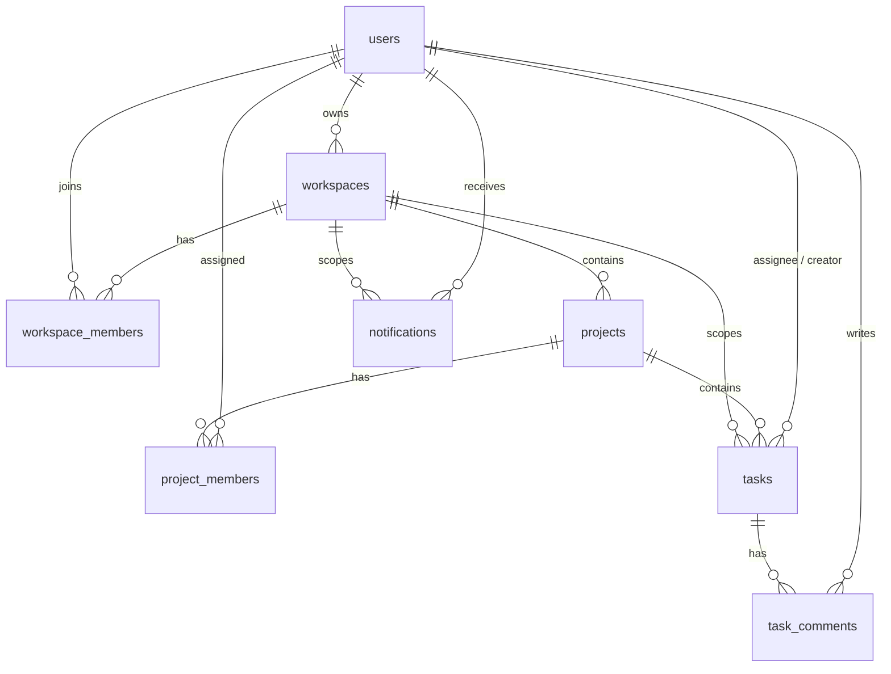

# DATABASE.md — Skema & Manajemen Database Taskora

Taskora menggunakan **TiDB** (MySQL-compatible, koneksi TLS/SSL via `mysql2`) yang dikelola dengan **Drizzle ORM** dan **Drizzle Kit Migrations**.

---

## 1. Konfigurasi Koneksi & Environment Variables

Koneksi diatur di [server/database/index.ts](file:///d:/Coding/ProjectTMTKemnaker/server/database/index.ts) dan [drizzle.config.ts](file:///d:/Coding/ProjectTMTKemnaker/drizzle.config.ts).

Salin [.env.example](file:///d:/Coding/ProjectTMTKemnaker/.env.example) menjadi `.env` dan isi:
- **Opsi 1 (Direkomendasikan untuk TiDB Cloud):** `DATABASE_URL=mysql://<user>:<password>@<host>:4000/<database>`
- **Opsi 2:** `TIDB_HOST`, `TIDB_PORT`, `TIDB_USER`, `TIDB_PASSWORD`, `TIDB_DATABASE`
- **TLS/SSL:** `TIDB_SSL=true` (wajib untuk TiDB Cloud; set `false` hanya untuk TiDB lokal tanpa TLS) dan opsional `TIDB_SSL_CA_PATH`.
- **Session:** `NUXT_SESSION_SECRET` (minimal 32 karakter acak).

> **Catatan Mode Preview:** Jika `.env` belum dikonfigurasi (`isDatabaseConfigured() === false`), server otomatis berjalan dalam mode preview menggunakan `server/utils/demo-store.ts`.

---

## 2. Entity Relationship Diagram (ERD)



---

## 3. Daftar 8 Tabel Utama

Semua primary key menggunakan `varchar(36)` (UUID) untuk mencegah *write hotspot* pada arsitektur terdistribusi TiDB.

### 1. `users` ([users.ts](file:///d:/Coding/ProjectTMTKemnaker/server/database/schema/users.ts))
Menyimpan akun pengguna.
- `id` (`varchar(36)`, PK)
- `name` (`varchar(120)`, not null)
- `email` (`varchar(255)`, unique `users_email_unique`, not null)
- `password_hash` (`varchar(255)`, not null — format `salt:scryptHex`)
- `avatar_url` (`varchar(500)`, nullable)
- `created_at`, `updated_at` (`timestamp`)

### 2. `workspaces` ([workspaces.ts](file:///d:/Coding/ProjectTMTKemnaker/server/database/schema/workspaces.ts))
Ruang kerja terisolasi per tim/klien.
- `id` (`varchar(36)`, PK)
- `name` (`varchar(120)`, not null)
- `slug` (`varchar(140)`, unique `workspaces_slug_unique`, not null)
- `description` (`text`, nullable)
- `owner_id` (`varchar(36)`, FK → `users.id`, `onDelete: restrict`)
- `created_at`, `updated_at` (`timestamp`)

### 3. `workspace_members` ([workspaces.ts](file:///d:/Coding/ProjectTMTKemnaker/server/database/schema/workspaces.ts))
Keanggotaan pengguna dan peran dalam workspace.
- `id` (`varchar(36)`, PK)
- `workspace_id` (`varchar(36)`, FK → `workspaces.id`, `onDelete: cascade`)
- `user_id` (`varchar(36)`, FK → `users.id`, `onDelete: cascade`)
- `role` (`enum('owner', 'member')`, default `'member'`)
- `joined_at` (`timestamp`)
- Unique constraint: `(workspace_id, user_id)`

### 4. `projects` ([projects.ts](file:///d:/Coding/ProjectTMTKemnaker/server/database/schema/projects.ts))
Daftar proyek dalam sebuah workspace.
- `id` (`varchar(36)`, PK)
- `workspace_id` (`varchar(36)`, FK → `workspaces.id`, `onDelete: cascade`)
- `name` (`varchar(160)`, not null)
- `description` (`text`, nullable)
- `status` (`enum('planned', 'active', 'on_hold', 'completed', 'archived')`, default `'active'`)
- `start_date`, `due_date` (`date`, nullable)
- `created_by` (`varchar(36)`, FK → `users.id`, `onDelete: restrict`)
- `created_at`, `updated_at` (`timestamp`)
- Index: `projects_workspace_idx`, `projects_workspace_status_idx`

### 5. `project_members` ([projects.ts](file:///d:/Coding/ProjectTMTKemnaker/server/database/schema/projects.ts))
Anggota workspace yang ditugaskan ke proyek tertentu.
- `id` (`varchar(36)`, PK)
- `project_id` (`varchar(36)`, FK → `projects.id`, `onDelete: cascade`)
- `user_id` (`varchar(36)`, FK → `users.id`, `onDelete: cascade`)
- `added_at` (`timestamp`)
- Unique constraint: `(project_id, user_id)`

### 6. `tasks` ([tasks.ts](file:///d:/Coding/ProjectTMTKemnaker/server/database/schema/tasks.ts))
Tugas dalam proyek, mendukung Kanban drag-and-drop dan bukti penyelesaian.
- `id` (`varchar(36)`, PK)
- `workspace_id` (`varchar(36)`, FK → `workspaces.id`, `onDelete: cascade`)
- `project_id` (`varchar(36)`, FK → `projects.id`, `onDelete: cascade`)
- `title` (`varchar(200)`, not null)
- `description` (`text`, nullable)
- `status` (`enum('todo', 'in_progress', 'review', 'done')`, default `'todo'`)
- `priority` (`enum('low', 'medium', 'high')`, default `'medium'`)
- `position` (`int`, default `0` — urutan kolom Kanban)
- `assignee_id` (`varchar(36)`, FK → `users.id`, `onDelete: set null`)
- `created_by` (`varchar(36)`, FK → `users.id`, `onDelete: restrict`)
- `due_date`, `completed_at` (`datetime`, nullable)
- `proof_url` (`text`, nullable — link bukti penyelesaian)
- `proof_image` (`mediumtext`, nullable — foto/screenshot bukti base64 maks. 2MB)
- `created_at`, `updated_at` (`timestamp`)
- Index: `tasks_workspace_idx`, `tasks_project_idx`, `tasks_kanban_order_idx`, `tasks_assignee_idx`, `tasks_due_date_idx`

### 7. `task_comments` ([tasks.ts](file:///d:/Coding/ProjectTMTKemnaker/server/database/schema/tasks.ts))
Komentar diskusi pada tugas.
- `id` (`varchar(36)`, PK)
- `task_id` (`varchar(36)`, FK → `tasks.id`, `onDelete: cascade`)
- `user_id` (`varchar(36)`, FK → `users.id`, `onDelete: cascade`)
- `content` (`text`, not null)
- `created_at`, `updated_at` (`timestamp`)

### 8. `notifications` ([notifications.ts](file:///d:/Coding/ProjectTMTKemnaker/server/database/schema/notifications.ts))
Notifikasi aktivitas per pengguna dan workspace.
- `id` (`varchar(36)`, PK)
- `workspace_id` (`varchar(36)`, FK → `workspaces.id`, `onDelete: cascade`)
- `user_id` (`varchar(36)`, FK → `users.id`, `onDelete: cascade`)
- `type` (`enum('task_assigned', 'task_status_changed', 'task_commented', 'task_due_soon', 'workspace_invited', 'project_added')`)
- `title` (`varchar(180)`, not null)
- `message` (`text`, nullable)
- `entity_type` (`varchar(50)`, nullable), `entity_id` (`varchar(36)`, nullable)
- `is_read` (`boolean`, default `false`, not null)
- `created_at` (`timestamp`)

---

## 4. Riwayat & Alur Migrasi

File migrasi tersimpan di `server/database/migrations/`:
1. `0000_colorful_miek.sql` — Pembuatan 8 tabel utama, index, dan foreign keys awal.
2. `0001_real_molecule_man.sql` — Penambahan kolom `proof_url` dan `proof_image` pada tabel `tasks`.

Perintah pengelolaan migrasi:
```bash
# Generate SQL migrasi baru setelah mengubah skema
npm run db:generate

# Terapkan migrasi ke TiDB
npm run db:migrate

# Buka Drizzle Studio (inspeksi data)
npm run db:studio
```
