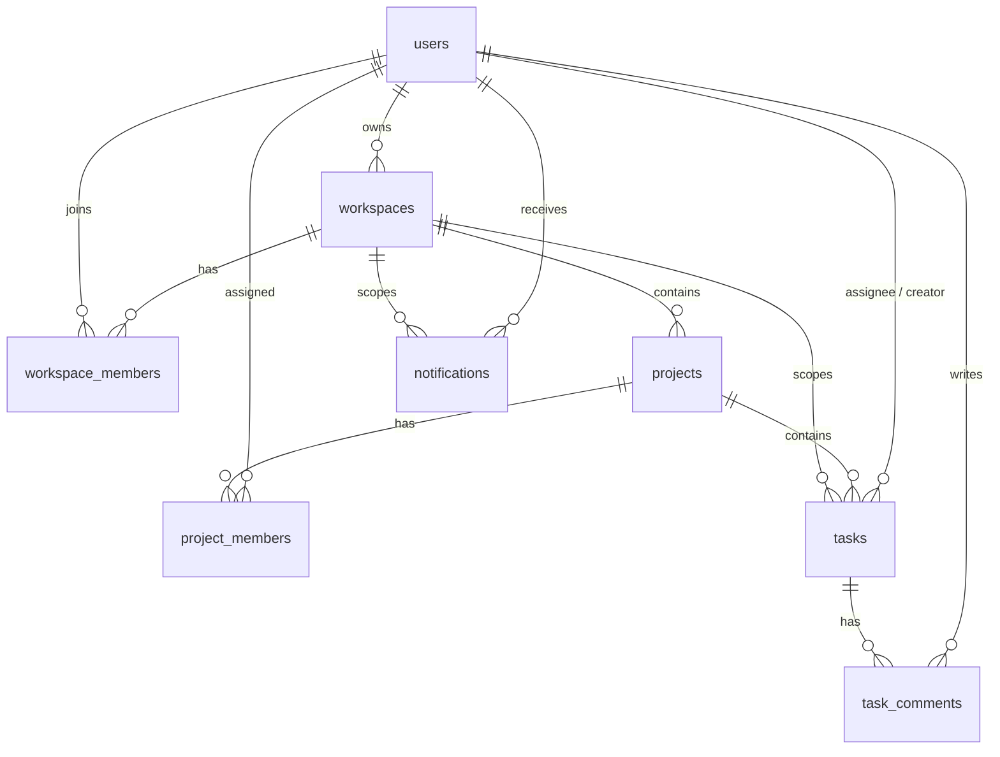

# Arsitektur Proyek — Taskora

Dokumen ini menjelaskan arsitektur aplikasi, struktur folder, rancangan database, dan konvensi pengembangan **Taskora** (Project & Task Management Platform).

---

## 1. Tech Stack

| Layer | Teknologi |
| --- | --- |
| Framework Full-Stack | Nuxt 4 (Vue 3 Composition API, TypeScript) |
| UI & Styling | Tailwind CSS v4, Nuxt UI, Lucide Icons (`@iconify-json/lucide` & `lucide-vue-next`) |
| Backend API | Nuxt Server API (Nitro) + Zod untuk validasi input |
| Database | TiDB (MySQL-compatible, koneksi TLS/SSL via `mysql2`) |
| ORM & Migrasi | Drizzle ORM & Drizzle Kit |

---

## 2. Arsitektur Aplikasi

Taskora memisahkan tanggung jawab menjadi beberapa lapisan agar kode mudah dikembangkan dan diuji:

```text
Browser / UI (app/pages, app/components)
       │
       ▼
Client State & Data Fetching (app/composables, app/middleware)
       │  HTTP / JSON
       ▼
Nuxt Server API Handlers (server/api/*)  ──► Validasi Input (Zod) + Cek Auth/RBAC (server/utils/*)
       │
       ▼
Business Logic Services (server/services/*)
       │
       ▼
Data Access Layer (server/database/index.ts & server/database/schema/*)
       │  MySQL Protocol over TLS
       ▼
TiDB Database
```

### Prinsip Isolasi Data (Multi-Workspace)
- Setiap resource utama (`projects`, `tasks`, `notifications`) memiliki kolom `workspace_id` yang terindeks.
- Setiap permintaan API pada tahap selanjutnya wajib memverifikasi keanggotaan pengguna di `workspace_members` sebelum membaca atau mengubah data.
- Hak akses mengikuti 3 role:
  - **Owner**: mengelola workspace, anggota, role, proyek, dan seluruh tugas.
  - **Admin**: mengelola proyek dan tugas dalam workspace.
  - **Member**: melihat proyek workspace/proyek terkait dan mengelola tugas yang menjadi tanggung jawabnya.

---

## 3. Struktur Folder

```text
.
├── app/                         # Frontend Nuxt 4
│   ├── app.vue                  # Root component (<UApp>, <NuxtLayout>, <NuxtPage>)
│   ├── app.config.ts            # Konfigurasi tema Nuxt UI (primary: indigo, neutral: slate)
│   ├── assets/css/main.css      # Entry Tailwind CSS v4 & Nuxt UI
│   ├── components/              # Komponen UI reusable (dipisah per domain)
│   ├── composables/             # Vue composables untuk state & API calls
│   ├── layouts/                 # Layout halaman (default, auth, dashboard)
│   ├── middleware/              # Route middleware (proteksi autentikasi & role)
│   └── pages/                   # File-based routing Nuxt 4
├── server/                      # Backend Nuxt Server API (Nitro)
│   ├── api/                     # Route handlers REST API (validasi + delegasi ke service)
│   ├── database/
│   │   ├── index.ts             # Connection pool mysql2 + instance Drizzle ORM untuk TiDB
│   │   ├── migrations/          # File SQL migrasi yang dihasilkan Drizzle Kit
│   │   └── schema/              # Definisi tabel & relasi Drizzle ORM
│   ├── services/                # Business logic terpisah dari HTTP handler
│   └── utils/                   # Helper autentikasi, password hashing, session, RBAC
├── shared/                      # Kode bersama antara client & server
│   └── types/domain.ts          # Konstanta & tipe domain (role, status, prioritas)
├── docs/
│   └── architecture.md          # Dokumentasi arsitektur & database
├── drizzle.config.ts            # Konfigurasi Drizzle Kit untuk migrasi TiDB
├── nuxt.config.ts               # Konfigurasi Nuxt 4, modules, & runtimeConfig
└── .env.example                 # Template environment variables
```

---

## 4. Rancangan Database (TiDB + Drizzle ORM)

Primary key menggunakan `UUID` (`varchar(36)`) untuk mencegah *write hotspot* pada arsitektur terdistribusi TiDB.

### Entity Relationship Diagram



### Ringkasan 8 Tabel Utama

| Tabel | Tujuan | Kolom Kunci & Relasi |
| --- | --- | --- |
| `users` | Akun pengguna | `id`, `name`, `email` (unique), `password_hash`, `avatar_url` |
| `workspaces` | Ruang kerja tim/agensi | `id`, `name`, `slug` (unique), `owner_id` → `users.id` |
| `workspace_members` | Keanggotaan & role workspace | `id`, `workspace_id`, `user_id`, `role` (`owner`/`admin`/`member`), unique `(workspace_id, user_id)` |
| `projects` | Daftar proyek dalam workspace | `id`, `workspace_id`, `name`, `description`, `status`, `start_date`, `due_date`, `created_by` |
| `project_members` | Anggota yang tergabung di proyek | `id`, `project_id`, `user_id`, unique `(project_id, user_id)` |
| `tasks` | Tugas proyek & posisi Kanban | `id`, `workspace_id`, `project_id`, `title`, `description`, `status` (`todo`/`in_progress`/`review`/`done`), `priority` (`low`/`medium`/`high`), `position`, `assignee_id`, `created_by`, `due_date`, `completed_at` |
| `task_comments` | Diskusi / komentar pada tugas | `id`, `task_id`, `user_id`, `content` |
| `notifications` | Notifikasi aktivitas pengguna | `id`, `workspace_id`, `user_id`, `type`, `title`, `message`, `entity_type`, `entity_id`, `is_read` |

---

## 5. Perintah Penting (Tahap 1)

1. Salin `.env.example` menjadi `.env` dan isi kredensial TiDB Anda.
2. Jalankan pengembangan lokal:
   ```bash
   npm run dev
   ```
3. Generate migrasi SQL dari skema Drizzle:
   ```bash
   npm run db:generate
   ```
4. Terapkan migrasi ke TiDB:
   ```bash
   npm run db:migrate
   ```
5. Cek tipe TypeScript:
   ```bash
   npm run typecheck
   ```
